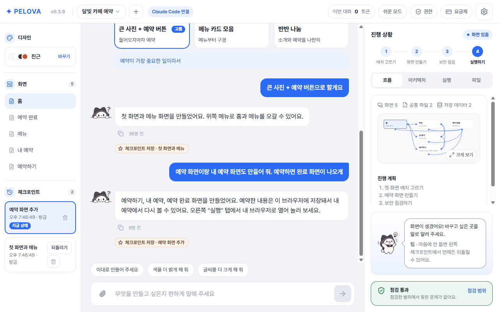
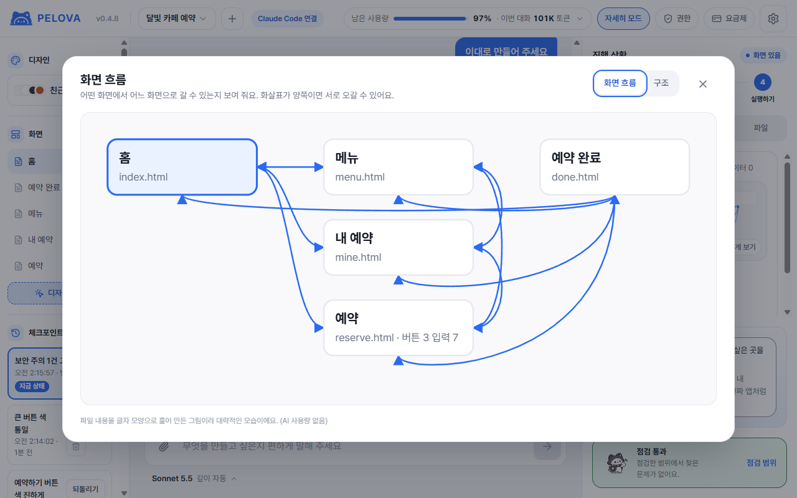
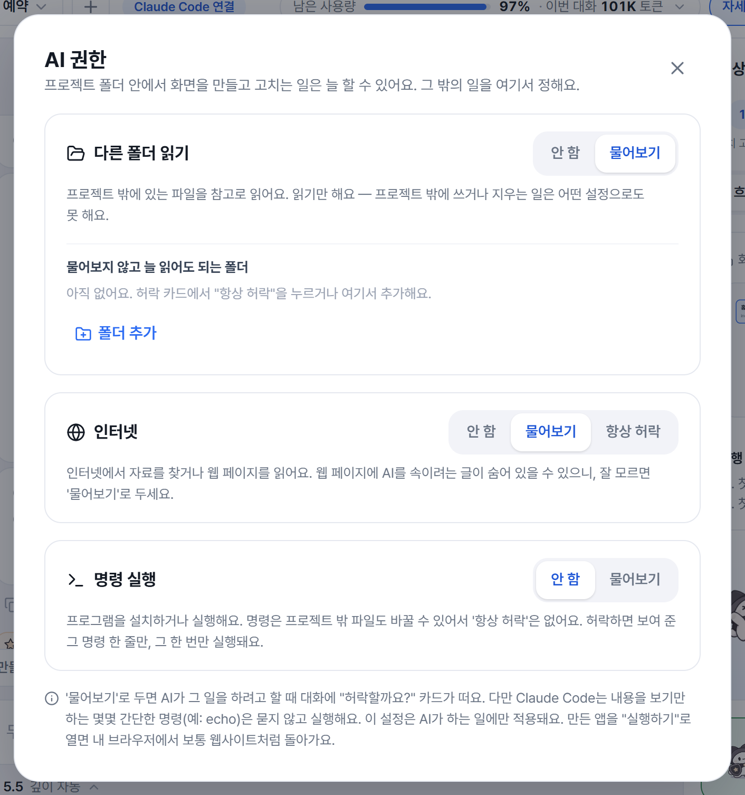

# 펠로바 PELOVA

### 정하고 나서 만드는 바이브코딩

코드를 몰라도 괜찮아요. 펠로바가 하나씩 물어보고, 고른 대로 Claude와 함께 화면을 만들어요. 
디자인 기준과 보안 점검은 기본으로 지켜요.

-0078D4)
-555555)

**[⬇ 내려받기 (Windows · 맥)](https://github.com/sangukjeon/pelova-releases/releases/latest)** &nbsp;·&nbsp;
**[🌐 공식 사이트](https://www.pelova.kr)** &nbsp;·&nbsp;
**[📝 버전 기록](CHANGELOG.md)**

 

  

## ✦ 펠로바는 이렇게 달라요

AI에게 "알아서 만들어 줘"라고 맡기면, 내가 원한 것과 다른 결과가 나오기 쉬워요. 
펠로바는 **만들기 전에 함께 정해요.**

<table>
  <tr>
    <td width="33%" valign="top">
      <h3>① 선택지로 정해요</h3>
      배치·색·기능을 2~3가지 선택지로 보여 줘요. 잘 모르면 <b>"추천대로"</b>를 누르면 돼요.
    </td>
    <td width="33%" valign="top">
      <h3>② 흔들리지 않는 디자인</h3>
      고른 분위기를 <code>design.md</code>에 저장해서, 화면이 늘어나도 같은 기준을 지켜요.
    </td>
    <td width="33%" valign="top">
      <h3>③ 내 컴퓨터는 내가 정해요</h3>
      AI 권한, 격리된 미리보기, 보안 점검, 서명된 업데이트로 안전하게 만들어요.
    </td>
  </tr>
</table>

## 🚀 이렇게 만들어요

| | 단계 | 하는 일 |
|:-:|---|---|
| 1 | **하고 싶은 걸 한 줄로** | "카페 예약 앱 만들고 싶어요"처럼 편하게 적어요. 다른 곳에서 만들던 프로젝트를 가져와도 돼요 |
| 2 | **선택지에서 골라요** | 분위기·배치·기능을 하나씩 정해요. 잘 모르면 추천대로 |
| 3 | **펠로바가 만들어요** | 오른쪽 미리보기에서 바로 눌러 보며 "색을 더 밝게"처럼 말로 고쳐요 |
| 4 | **점검 통과, 실행!** | 보안 점검을 통과하면 내 브라우저·휴대폰에서 열고, 원하는 폴더로 내보내요 |

## 🧰 할 수 있는 것

- 🎨 **선택지로 정하고 만들기** — 고른 디자인 기준을 모든 화면에 똑같이 적용해요
- 🛡️ **보안 점검과 관문** — 비밀값·위험한 코드를 찾아요. 꼭 고칠 문제가 있으면 실행이 잠겨요
- ⏪ **체크포인트·되돌리기** — 만들 때마다 저장돼서 언제든 되돌릴 수 있어요
- ▶️ **바로 실행** — 내 브라우저에서 열거나, 같은 와이파이의 휴대폰에서 QR 코드로 열어요
- 🗺️ **화면 흐름·구조 그림** — 어떤 화면에서 어디로 가는지, 무엇을 함께 쓰는지 그림으로 봐요
- 📁 **프로젝트 관리** — 여러 프로젝트를 골라 열고, 가져오고, 원하는 폴더로 내보내요

<table>
  <tr>
    <td width="50%">
화면 흐름·구조 그림
</td>
    <td width="50%">
AI 권한 설정
</td>
  </tr>
</table>

## ⬇ 내려받기

👉 **[최신 버전 내려받기](https://github.com/sangukjeon/pelova-releases/releases/latest)**

### Windows 10·11 (64비트)

| 파일 | 용도 |
|---|---|
| `PELOVA_<버전>_x64-setup.exe` | 일반 설치 파일 **(추천)**. 관리자 권한 없이 내 계정에 설치돼요 |
| `PELOVA_<버전>_x64_ko-KR.msi` | 회사·학교 PC 일괄 설치용 |

> [!NOTE]
> 코드 서명 인증서가 아직 없어서 처음 설치할 때 **"Windows의 PC 보호"** 창이 뜰 수 있어요. **추가 정보 → 실행**을 누르면 설치돼요.

### macOS 11 이상 (Apple Silicon · Intel)

| 파일 | 용도 |
|---|---|
| `PELOVA_<버전>_universal.dmg` | 맥 설치 파일. 열어서 **PELOVA**를 **응용 프로그램** 폴더로 끌어 놓아요 |

> [!NOTE]
> 애플 개발자 서명이 아직 없어서 처음 열 때 **"확인되지 않은 개발자"** 경고가 떠요.
> 1. 경고 창을 닫고 **시스템 설정 → 개인정보 보호 및 보안**으로 가요.
> 2. 아래쪽의 **"그래도 열기"** 를 누르고 암호로 확인해요. (처음 한 번만)
>
> "손상되었기 때문에 열 수 없습니다"라고 뜨면, 응용 프로그램 폴더로 옮긴 뒤 터미널에서 `xattr -dr com.apple.quarantine /Applications/PELOVA.app`를 실행하고 다시 열어요. 
> 자동 업데이트가 되려면 앱이 **응용 프로그램 폴더**에 있어야 해요.

설치 파일은 이 저장소의 배포판(Releases)에서만 받아 주세요.

## 🤖 AI 연결

| 방식 | 필요한 것 | 요금 |
|---|---|---|
| **내 Claude Code** | [Claude Code](https://code.claude.com/docs) 설치·로그인 | 내 Claude 구독 사용량 |
| **내 API 키** | Anthropic API 키 ([Claude Console](https://console.anthropic.com/settings/keys)) | 쓴 만큼 내 Anthropic 계정 |
| **연습 모드** | 없음 | 무료 (예시 답으로 둘러보기) |

API 키는 이 컴퓨터의 **Windows 자격 증명 관리자에만** 저장돼요. 펠로바 서버로 보내지 않아요.

## 🔒 안전

- **AI 권한** — 다른 폴더 읽기·인터넷·명령 실행을 직접 정하고, 필요할 때 "허락할까요?"로 물어봐요
- **격리된 미리보기** — 만든 화면은 앱과 떨어진 칸에서 돌아가 인터넷이나 내 파일에 닿지 못해요
- **서명된 업데이트** — 펠로바 서명이 확인된 파일만 설치해요
- 만든 앱과 대화는 **내 컴퓨터에만** 저장돼요. 보안 점검은 보증이 아니에요

## 🔄 업데이트

앱을 켜면 이 저장소의 최신 배포판을 확인해서, 새 버전이 있으면 업데이트 창을 띄워요. 만든 프로젝트와 설정은 그대로 남아요. 
버전별 바뀐 점은 **[CHANGELOG.md](CHANGELOG.md)** 에 있어요.

---

지금은 <b>개발 중인 미리보기 버전</b>이라 바뀌는 부분이 많아요. 
이 저장소에는 설치 파일과 버전 정보만 있어요. 앱 소스 코드는 공개하지 않아요. 펠로바(PELOVA)는 가칭이에요. 
<a href="https://www.pelova.kr">www.pelova.kr</a>

